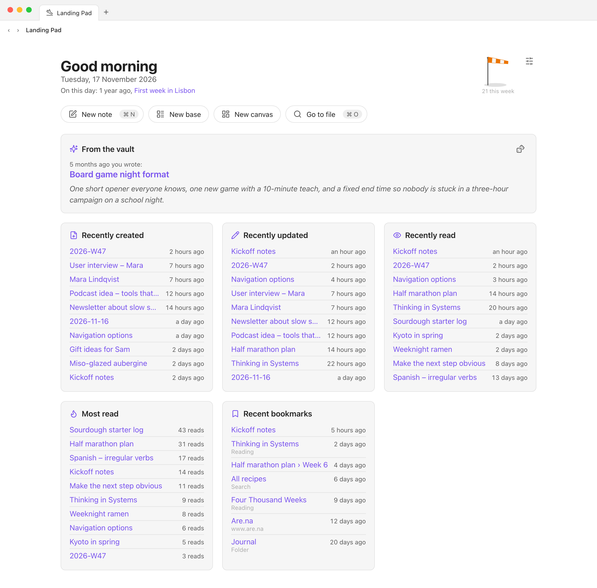
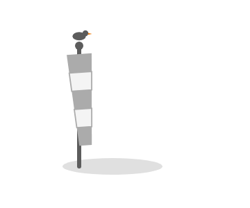

# Landing Pad

The page you land on when you open Obsidian. It shows what you actually read, and brings back what you forgot.

## What's on it

- **From the vault.** One note you haven't edited or read in 30 days, with a short preview. A new one each day; press the dice for another.
- **Quick actions:** new note, new base, new canvas and go to file, with your own hotkeys shown next to them.
- **Recently created, recently edited, recently read.**
- **Most read.** A note only counts as read once it has been open for 5 seconds, so clicking past it doesn't count.
- **Recent bookmarks**, from Obsidian's Bookmarks: notes, headings, blocks, folders, searches and links.
- **A greeting** that fits the time of day, and notes you wrote **on this day** in earlier years.
- **A windsock** that shows how much you wrote this week, compared with your own usual pace. Straight out and flapping in a busy week, limp with a bird on the pole when you haven't written for a few days.

## Install

Not in the community plugin directory yet. To try it now, install it with the [BRAT](https://github.com/TfTHacker/obsidian42-brat) plugin: **Add beta plugin** → `chaeringer/landing-pad`.

Landing Pad opens when Obsidian starts and in every new empty tab. You can also open it from the plane icon in the ribbon or with the command **Landing Pad: Open Landing Pad**.

## Make it yours

Click the **sliders button** at the top right to show or hide each part of the page and choose how many items each list shows. Right-click a card (long-press on mobile) to move it up or down, or hide it. Everything else is under **Settings → Landing Pad**.

| Setting | Default | |
|---|---|---|
| Open on startup | On | Show Landing Pad when Obsidian starts |
| Replace new tabs | On | Show Landing Pad in new empty tabs |
| Items per list | 10 | 3 to 30 |
| Seconds before a note counts as read | 5 | 0 to 60 |
| Excluded folders | Your templates folder, if set | Notes in these folders don't appear in the lists |
| On the page | All on | Greeting, windsock, quick actions, from the vault, and each list card |

## Privacy

Landing Pad makes no network requests and collects no data. Read counts are stored only in your vault, in the plugin's settings file, one section per device. If you sync your vault, the counts from all your devices are added together.

## Good to know

- **Read counts start when you install the plugin.** Earlier reads aren't known to Obsidian.
- **Created dates** come from the file system. Syncing, cloning or importing can reset them.
- **Bookmarks** use Obsidian's core Bookmarks plugin. If it's turned off, the card is hidden.
- **Some features use parts of Obsidian outside the official plugin API:** bookmarks, revealing bookmarked folders and searches, quick-action hotkeys, opening the settings tab. If an Obsidian update changes one of them, only that feature stops working, with a short message; the rest of Landing Pad keeps going.

## Development

- `main.js` and `styles.css` are the plugin. Copy them with `manifest.json` into `.obsidian/plugins/landing-pad/` of a test vault.
- `npm test` runs the test suite against a mocked Obsidian API.
- `docs/screenshots/` renders the README screenshots from the real code with a demo vault.

## Feedback

Bugs and ideas: [GitHub issues](https://github.com/chaeringer/landing-pad/issues).

## Licence

MIT
